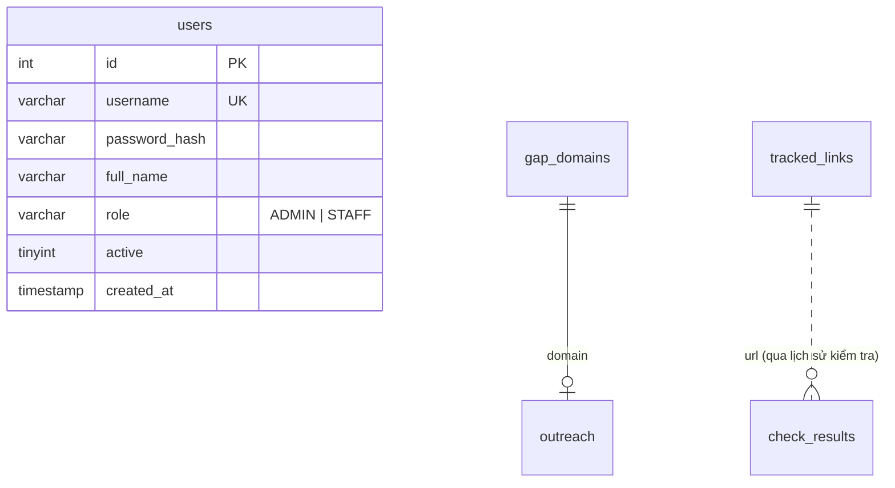

# Nội dung bổ sung cho báo cáo (phiên bản 3.0)

Tài liệu này gom các phần có thể đưa thẳng vào báo cáo cho 4 tính năng mới. Các ô **[...]** là số liệu
em cần tự đo bằng dữ liệu thật của công ty — đừng điền số ước chừng.

## 1. Phân tích yêu cầu (mục bổ sung)

| Mã | Yêu cầu | Tác nhân |
|----|---------|----------|
| FR-A1 | Đăng nhập bằng tên đăng nhập + mật khẩu | Admin, Nhân viên |
| FR-A2 | Phân quyền: Nhân viên không vào Cài đặt / Người dùng | Admin |
| FR-A3 | Quản lý tài khoản (thêm, đặt lại mật khẩu, đổi vai trò, khoá, xoá) | Admin |
| FR-S1 | Tự động kiểm tra toàn bộ backlink theo giờ cấu hình mỗi ngày | Hệ thống |
| FR-S2 | Gửi email khi phát hiện link từng Dofollow nay bị mất/đổi | Hệ thống |
| NFR-1 | Mật khẩu không lưu bản rõ; không thể tự khoá hệ thống (luôn còn ≥ 1 admin) | — |
| NFR-2 | Lỗi mạng tạm thời (timeout/chặn bot) không gây cảnh báo giả | — |

## 2. Thay đổi cơ sở dữ liệu (ERD)

Thêm bảng `users`; các bảng còn lại giữ nguyên.

`users` độc lập với 5 bảng nghiệp vụ (không có khoá ngoại), vì hiện app chưa ghi lại "ai đã làm gì".

## 3. Thiết kế & lý do chọn (câu giảng viên hay hỏi)

- **PBKDF2 thay vì MD5/SHA-256 thuần**: băm chậm có chủ đích (120.000 vòng) + salt ngẫu nhiên → chống dò
  bảng băm dựng sẵn. Dùng thư viện có sẵn của JDK nên không thêm phụ thuộc.
- **`PreparedStatement` ở mọi DAO** → chống SQL injection (đã kiểm thử bằng chuỗi `' OR '1'='1`).
- **Tách hàm thuần khỏi I/O** (`DofollowCheckerService.classify`, `GapDomain.calculatePriorityScore(…, w1, w2)`,
  `LinkAlertService`, `SchedulerService.secondsUntilNextRun`) → unit test không cần MySQL/Internet.
- **`ScheduledExecutorService` + luồng daemon**: lịch chạy nền không chặn giao diện, không giữ app khi đóng.
  Hạn chế: app desktop chỉ chạy lịch khi đang mở (muốn chạy 24/7 cần tách thành service/cron trên server).
- **Chỉ báo khi chuyển trạng thái** (`prev_status` → `last_status`): link mất sẽ báo 1 lần, không spam mỗi ngày.

## 4. Kết quả kiểm thử

### 4.1 Unit test (`mvn test`) — 63 test, 63 đạt

| Lớp test | Số test | Nội dung chính |
|----------|--------:|----------------|
| `GapDomainTest` | 12 | Công thức điểm, trọng số tuỳ chỉnh, các mốc 60/80/100 |
| `DofollowCheckerServiceTest` | 12 | rel rỗng / nofollow / `noopener nofollow` / viết hoa; nhiều link; không có link; domain tuỳ chọn |
| `BatchCheckServiceTest` | 5 | Đủ URL, đúng thứ tự chỉ số, nhiều luồng, 1 URL lỗi không dừng batch, danh sách rỗng |
| `TrackedLinkTest` | 5 | Quy tắc "mất link" |
| `LinkAlertServiceTest` | 5 | Chọn link cần báo, bỏ qua lỗi tạm thời, nội dung email |
| `SchedulerServiceTest` | 5 | Giờ chạy kế tiếp (trước/sau giờ, đúng giờ, qua nửa đêm), parse giờ |
| `PasswordHasherTest` | 6 | Đúng/sai mật khẩu, salt khác nhau, chuỗi hỏng, tiếng Việt |
| `UserRoleTest` | 4 | Parse vai trò, vai trò lạ → STAFF |
| `AuthServiceTest` | 2 | Độ dài mật khẩu tối thiểu |
| `UiUtilTest` | 7 | Chuẩn hoá domain, parse ngày, ngày không tồn tại |

**Lỗi thật do unit test tìm ra:** `UiUtil.parseDate("31/02/2026")` trước đây không báo lỗi mà tự đổi thành
28/02/2026 (do `DateTimeFormatter` mặc định ở chế độ SMART). Đã sửa sang `ResolverStyle.STRICT`.

### 4.2 Kiểm thử tích hợp (MySQL thật, web giả, SMTP giả) — 29/29 đạt

Đã chạy: khởi tạo schema 2 lần không tạo trùng admin; đăng nhập đúng/sai/không phân biệt hoa thường; SQL injection
bị chặn; nhân viên không phải admin; không tự khoá mình / không bỏ admin cuối; tài khoản bị khoá không vào được;
đổi mật khẩu; hash trong DB không chứa mật khẩu; `MonitorRunner` phát hiện link Dofollow → Nofollow, **gửi đúng 1
email**, lượt sau không báo lặp; mỗi lượt đều ghi lịch sử kiểm tra.

## 5. Chứng minh app dùng thật (điền số liệu của em)

| Chỉ số | Giá trị |
|--------|---------|
| Số URL đã kiểm tra trong đợt thật | **[...]** |
| Số link Dofollow / Nofollow / Không tìm thấy / Lỗi | **[...]** / **[...]** / **[...]** / **[...]** |
| Thời gian kiểm tra bằng app (5 luồng) | **[...]** phút |
| Thời gian làm tay cùng số URL (em tự bấm đồng hồ 10 URL rồi nhân lên) | **[...]** phút |
| Số lần app phát hiện link bị mất/đổi | **[...]** |

Gợi ý cách lấy số: tab **Lịch sử kiểm tra** lọc theo trạng thái cho số lượng; tab **Thống kê** có sẵn biểu đồ tỷ lệ
Dofollow; xuất Excel làm phụ lục.
